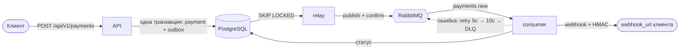

# Payment Service — асинхронный процессинг платежей

Микросервис принимает запрос на оплату, **гарантированно** ставит его в очередь, обрабатывает через эмуляцию
платёжного шлюза и уведомляет клиента подписанным webhook-ом.

**Стек:** Python 3.12 · FastAPI + Pydantic v2 · SQLAlchemy 2 (async) + asyncpg · PostgreSQL · RabbitMQ (FastStream) ·
Alembic · Docker Compose · uv · ruff · mypy (strict) · pytest (+ testcontainers).



Что здесь важно (подробности — в [docs/ARCHITECTURE.md](docs/ARCHITECTURE.md), план — в [docs/PLAN.md](docs/PLAN.md)):

| Требование | Реализация |
|---|---|
| Гарантированная публикация | **Transactional Outbox**: платёж и событие пишутся в одной транзакции, relay публикует с publisher confirms |
| Защита от дублей | `Idempotency-Key` (UNIQUE + отпечаток тела) на API; CAS-обновление статуса в consumer |
| Retry | 3 попытки, экспоненциальная задержка (5 с → 10 с) через wait-очереди RabbitMQ с TTL |
| Dead Letter Queue | `payments.new.dlq` — после 3-й неудачи, с причиной в заголовках |
| Безопасность | `X-API-Key` (constant-time), защита от SSRF в `webhook_url`, HMAC-подпись webhook, non-root контейнеры |

## Быстрый старт

Нужны Docker с Compose v2. Больше ничего устанавливать не требуется.

```bash
cp .env.example .env            # при необходимости поменяйте секреты (API_KEY, WEBHOOK_SIGNING_SECRET, пароли)
docker compose --profile demo up --build -d
docker compose ps               # все сервисы healthy / migrate завершился (exited 0)
```

Профиль `demo` добавляет `webhook-sink` — приёмник webhook, чтобы увидеть результат без внешних сервисов.
Если порт на хосте занят, переопределите его в `.env`: `API_HOST_PORT`, `POSTGRES_HOST_PORT`, `RABBITMQ_AMQP_HOST_PORT`,
`RABBITMQ_UI_HOST_PORT`, `WEBHOOK_SINK_HOST_PORT` (порты открыты только на `127.0.0.1`). Ниже в примерах — порты по умолчанию.

| Сервис | Адрес |
|---|---|
| API + Swagger UI | http://localhost:8000 · http://localhost:8000/docs |
| RabbitMQ Management | http://localhost:15672 (логин/пароль — `RABBITMQ_DEFAULT_USER/PASS` из `.env`) |
| webhook-sink (demo) | http://localhost:9000/received |
| PostgreSQL | `127.0.0.1:5432` |

Остановить: `docker compose --profile demo down` (с `-v` — удалить и данные).

## Примеры

Ключ берём из `.env` (`API_KEY`). Внутри docker-сети приёмник доступен как `http://webhook-sink:9000`.

```bash
export API_KEY=...   # значение из .env

# 1. Создать платёж (202 Accepted)
curl -s -X POST http://localhost:8000/api/v1/payments \
  -H "X-API-Key: $API_KEY" -H "Idempotency-Key: order-42" -H "Content-Type: application/json" \
  -d '{"amount":"100.50","currency":"RUB","description":"Order #42","metadata":{"order_id":42},
       "webhook_url":"http://webhook-sink:9000/ok"}'
# {"payment_id":"…","status":"pending","created_at":"…"}

# 2. Повтор с тем же ключом и телом → тот же платёж (заголовок Idempotent-Replayed: true)
# 3. Тот же ключ с другим телом → 422, code = idempotency-key-reused

# 4. Получить платёж (через 2–5 с статус succeeded | failed)
curl -s http://localhost:8000/api/v1/payments/<payment_id> -H "X-API-Key: $API_KEY"

# 5. Что получил webhook-sink (подпись проверена приёмником)
curl -s http://localhost:9000/received
```

### Сценарии, которые стоит посмотреть

| Что проверить | Как |
|---|---|
| Успех / бизнес-отказ (≈90 % / 10 %) | создайте несколько платежей — статус `succeeded` или `failed`; в обоих случаях приходит webhook |
| Retry → успех | `webhook_url = http://webhook-sink:9000/flaky`: первые два вызова вернут 500, третий — 200 (в логах consumer видны попытки) |
| Retry → DLQ | `webhook_url = http://webhook-sink:9000/fail`: через ≈ 5 с и ≈ 10 с повторы, затем сообщение в очереди `payments.new.dlq` (RabbitMQ UI → Queues → открыть → *Get messages*; причина — в заголовках `x-error-*`) |
| Идемпотентность под нагрузкой | отправьте один и тот же запрос параллельно — в БД будет один платёж |
| Авторизация | запрос без `X-API-Key` → 401 `application/problem+json` |
| Защита от SSRF | `webhook_url = http://169.254.169.254/latest` → 422 `invalid-webhook-url` (адреса link-local/metadata запрещены всегда; приватные сети разрешены только в демо, см. `WEBHOOK_ALLOW_PRIVATE_NETWORKS`) |

Автоматическая проверка всех сценариев на поднятом стенде:

```bash
make smoke       # = uv run python scripts/smoke_test.py (читает API_KEY и параметры RabbitMQ из .env)
```

## Контракт API

Полная спецификация: [docs/openapi.json](docs/openapi.json) (и Swagger UI на `/docs`).

| Метод и путь | Назначение | Коды |
|---|---|---|
| `POST /api/v1/payments` | создать платёж; заголовки `X-API-Key`, `Idempotency-Key` | 202, 400, 401, 422 |
| `GET /api/v1/payments/{payment_id}` | получить платёж | 200, 401, 404, 422 |
| `GET /health/live`, `GET /health/ready` | пробы (без ключа) | 200, 503 |

Ошибки — `application/problem+json` (RFC 9457) с полями `type, title, status, detail, code, request_id`.
Суммы передаются **строкой** (`"100.50"`), чтобы не терять точность.

### Webhook

`POST <webhook_url>`, тело — JSON с `payment_id`, `status`, `amount`, `currency`, `description`, `metadata`, `created_at`, `processed_at`.
Подпись: заголовки `X-Timestamp` и `X-Signature: sha256=<hex>`, где HMAC-SHA256 считается над `"<timestamp>.<тело>"`
ключом `WEBHOOK_SIGNING_SECRET`. Проверка на стороне получателя:

```python
import hashlib, hmac, time


def is_valid(secret: str, timestamp: str, body: bytes, signature: str, tolerance: int = 300) -> bool:
    if abs(time.time() - int(timestamp)) > tolerance:
        return False
    expected = (
        "sha256=" + hmac.new(secret.encode(), timestamp.encode() + b"." + body, hashlib.sha256).hexdigest()
    )
    return hmac.compare_digest(expected, signature)
```

Доставка webhook — *at-least-once*: получатель должен быть идемпотентным (дедупликация по `payment_id`).
Успешный ответ — любой `2xx`; остальное (и таймаут) считается ошибкой и ретраится.

## Конфигурация

Все параметры — переменные окружения (см. [.env.example](.env.example)); обязательные: `DB_URL`, `RABBIT_URL`, `API_KEY`,
`WEBHOOK_SIGNING_SECRET` — без них процесс не стартует.

| Группа | Переменные (по умолчанию) |
|---|---|
| `RETRY_*` | `MAX_ATTEMPTS=3`, `BASE_DELAY_SECONDS=5`, `BACKOFF_FACTOR=2` |
| `OUTBOX_*` | `BATCH_SIZE=100`, `POLL_INTERVAL_SECONDS=0.5`, `RETENTION_HOURS=72` |
| `GATEWAY_*` | `MIN_DELAY_SECONDS=2`, `MAX_DELAY_SECONDS=5`, `SUCCESS_RATE=0.9` |
| `RABBIT_*` | `PREFETCH_COUNT=10`, `QUEUE_TYPE=quorum` |
| `WEBHOOK_*` | `TIMEOUT_SECONDS=5`, `ALLOW_PRIVATE_NETWORKS=false` (в compose-демо `true` только для `api`/`consumer`, чтобы достучаться до `webhook-sink`; link-local/metadata запрещены всегда) |
| `LOG_*` | `LEVEL=INFO`, `JSON_FORMAT=true` |

## Разработка

```bash
uv sync                     # окружение из uv.lock
make check                  # ruff + mypy + быстрые тесты
make test-all               # все тесты с покрытием (интеграционные поднимают Postgres и RabbitMQ в Docker)
make help                   # остальные команды
```

Правила и стиль — [docs/CONTRIBUTING.md](docs/CONTRIBUTING.md). Тесты:

- `tests/unit` — без Docker: валидация, подпись, SSRF-защита, retry-политика, API (ASGI), воркер;
- `tests/integration` — реальные PostgreSQL и RabbitMQ (testcontainers): идемпотентность под гонкой, outbox/`SKIP LOCKED`,
  CAS-обработка дублей, retry → DLQ, poison-сообщения, дрейф схемы миграций; сквозной сценарий API → outbox → брокер → consumer → webhook.

```
src/payment_service/
├── api/          # FastAPI: роуты, схемы, ошибки (problem+json), ключ API, request-id
├── services/     # use-cases: PaymentService, PaymentProcessor, OutboxRelay, адаптеры шлюза/webhook
├── messaging/    # топология RabbitMQ, publisher, retry/DLQ, consumer (FastStream)
├── persistence/  # модели, репозитории, Unit of Work
├── domain/       # enum-ы, события, исключения
├── common/       # воркер, netguard (SSRF), сигналы, время
└── entrypoints/  # процессы relay и consumer
```

## Эксплуатация

```sql
-- платежи, «зависшие» в pending дольше 5 минут (индекс ix_payments_status_created_at)
SELECT id, created_at FROM payments WHERE status = 'pending' AND created_at < now() - interval '5 minutes';

-- отставание outbox: сколько событий ждут публикации и возраст самого старого
SELECT count(*), now() - min(created_at) AS oldest FROM outbox WHERE published_at IS NULL;
```

Сообщения из `payments.new.dlq` после устранения причины можно вернуть в работу в RabbitMQ Management
(*Queues → payments.new.dlq → Move messages* в `payments` с ключом `payments.new`): обработка идемпотентна, повторный прогон безопасен.

## Ограничения и развитие

Один статический ключ (нет клиентов/ротации), нет rate limiting, метрик и трейсинга; идемпотентный ключ глобален.
Подробный список и обоснования решений — [docs/ARCHITECTURE.md](docs/ARCHITECTURE.md), разделы 10–11.

## Документация

| Документ | О чём |
|---|---|
| [docs/PLAN.md](docs/PLAN.md) | план разработки, допущения, этапы, риски, Definition of Done |
| [docs/ARCHITECTURE.md](docs/ARCHITECTURE.md) | схема, топология RabbitMQ, гарантии доставки, безопасность, ADR |
| [docs/DATABASE.md](docs/DATABASE.md) | схема БД, индексы, `EXPLAIN ANALYZE` реальных запросов |
| [docs/CONTRIBUTING.md](docs/CONTRIBUTING.md) | правила кода, команды, стратегия тестов |
| [docs/openapi.json](docs/openapi.json) | контракт HTTP API (генерируется: `make openapi`) |
