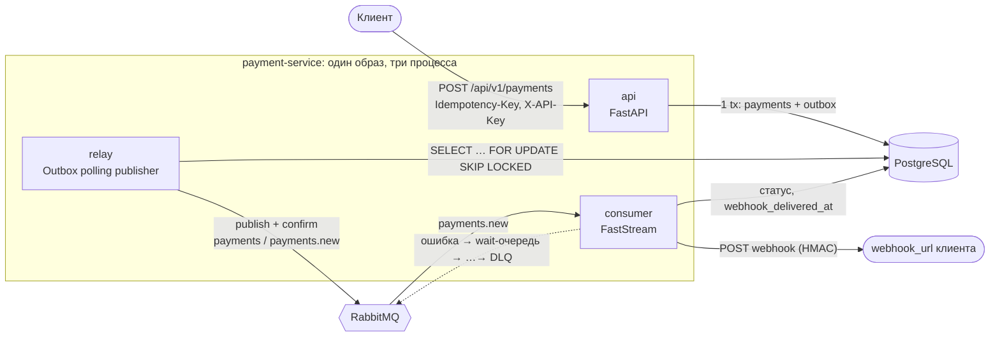

# Архитектура

Документ — источник правды для реализации. Разделы 4–8 описывают **контракты**, которые обязаны соблюдать
все модули; отклонения — только через правку этого документа.

## 1. Обзор



### Жизненный цикл платежа

```mermaid
sequenceDiagram
    participant C as Клиент
    participant A as API
    participant DB as PostgreSQL
    participant R as Relay
    participant Q as RabbitMQ
    participant W as Consumer
    participant H as Webhook клиента
    C->>A: POST /payments (Idempotency-Key)
    A->>DB: BEGIN; INSERT payment ON CONFLICT DO NOTHING; INSERT outbox; COMMIT
    A-->>C: 202 {payment_id, status: pending, created_at}
    loop poll
        R->>DB: SELECT … WHERE published_at IS NULL FOR UPDATE SKIP LOCKED
        R->>Q: publish (persistent, mandatory) + publisher confirm
        R->>DB: UPDATE published_at; COMMIT
    end
    Q->>W: payments.new (event)
    W->>DB: прочитать платёж
    W->>W: эмуляция шлюза 2–5 с (вне транзакции)
    W->>DB: UPDATE … WHERE status='pending' (CAS)
    W->>H: POST webhook (подпись HMAC)
    alt 2xx
        W->>DB: webhook_delivered_at = now()
        W->>Q: ack
    else ошибка доставки
        W->>Q: republish в wait-очередь (x-attempt+1) + ack
        Note over Q,W: через TTL сообщение возвращается в payments.new
    end
```

## 2. Процессы

| Процесс | Команда | Роль | Масштабирование |
|---|---|---|---|
| `api` | `uvicorn payment_service.api.app:create_app --factory` | принять запрос, записать платёж + outbox | горизонтально, stateless |
| `relay` | `python -m payment_service.entrypoints.relay` | доставить outbox в брокер | горизонтально (`SKIP LOCKED`) |
| `consumer` | `python -m payment_service.entrypoints.consumer` | обработать платёж, отправить webhook | горизонтально; конкурентность = `RABBIT_PREFETCH_COUNT` |
| `migrate` | `alembic upgrade head` | one-shot перед стартом остальных | — |

Один образ, разные команды — единая сборка и единые зависимости.

## 3. Структура пакета

```
src/payment_service/
├── config.py            # настройки (группы с env-префиксами, SecretStr)
├── logging_config.py    # JSON-логи + contextvars (request_id / correlation_id)
├── common/
│   ├── time.py          # utcnow()
│   └── worker.py        # BackgroundWorker: цикл, stop-event, backoff при ошибках
├── domain/              # словарь предметной области, без фреймворков
│   ├── enums.py         # Currency, PaymentStatus
│   ├── events.py        # PaymentCreatedEvent
│   └── exceptions.py    # AppError (+ подклассы), WebhookDeliveryError
├── persistence/         # единственное место с SQL
│   ├── base.py models.py database.py uow.py repositories.py
├── services/            # use-cases и порты
│   ├── interfaces.py    # PaymentGateway, WebhookSender, EventPublisher (ABC)
│   ├── dto.py           # CreatePaymentCommand, PaymentDTO, CreatePaymentResult
│   ├── payments.py      # PaymentService (create/get)
│   ├── processor.py     # PaymentProcessor (идемпотентная обработка)
│   ├── outbox.py        # OutboxRelay(BackgroundWorker)
│   ├── gateway.py       # EmulatedPaymentGateway
│   └── webhook.py       # HttpWebhookSender: SSRF-защита, HMAC, httpx
├── messaging/
│   ├── topology.py      # имена и декларация exchanges/queues/bindings
│   ├── publisher.py     # RabbitEventPublisher(EventPublisher)
│   ├── retry.py         # RetryPolicy, RetryRouter (wait-очереди, DLQ)
│   └── consumer.py      # PaymentConsumer + сборка FastStream app
├── api/
│   ├── app.py           # create_app(), lifespan
│   ├── security.py      # проверка X-API-Key
│   ├── schemas.py       # Pydantic v2
│   ├── errors.py        # обработчики ошибок, problem+json
│   ├── middleware.py    # request-id
│   ├── dependencies.py  # Depends-провайдеры
│   └── routes/{payments,health}.py
├── entrypoints/{consumer,relay}.py   # composition roots воркеров
└── tools/webhook_sink.py             # демо-приёмник webhook (compose profile "demo")
migrations/              # Alembic (async env.py)
```

Правило зависимостей: `api`, `entrypoints`, `messaging.consumer` → `services` → `persistence` / порты → `domain`.
Модули use-case'ов (`payments`, `processor`, `outbox`) **не импортируют** FastAPI, FastStream, httpx, aio-pika и зависят только
от портов из `interfaces.py`. Адаптеры портов (`services/webhook.py` — httpx, `services/gateway.py`, `messaging/publisher.py` — FastStream)
— единственные места, где живут клиентские библиотеки; подменяются в тестах и не протекают в бизнес-логику.

## 4. Данные

### `payments`

| Колонка | Тип | Примечание |
|---|---|---|
| `id` | UUID PK | генерируется приложением |
| `amount` | NUMERIC(18,2) | `CHECK (amount > 0)`; в JSON — строкой, **не float** |
| `currency` | VARCHAR(3) | `CHECK IN ('RUB','USD','EUR')` |
| `description` | TEXT | |
| `metadata` | JSONB | атрибут ORM `metadata_` |
| `status` | VARCHAR(16) | `CHECK IN ('pending','succeeded','failed')`, default `pending` |
| `idempotency_key` | VARCHAR(255) | `UNIQUE` |
| `request_fingerprint` | VARCHAR(64) | SHA-256 канонического тела |
| `webhook_url` | VARCHAR(2048) | |
| `created_at` / `processed_at` / `webhook_delivered_at` | TIMESTAMPTZ | |

Индексы: `uq_payments_idempotency_key`, `ix_payments_status_created_at` (мониторинг «зависших» pending).

### `outbox`

| Колонка | Тип | Примечание |
|---|---|---|
| `id` | UUID PK | он же `event_id` и `message_id` |
| `event_type` | VARCHAR(100) | routing key (`payments.new`) |
| `aggregate_id` | UUID | id платежа |
| `payload` | JSONB | тело сообщения |
| `correlation_id` | VARCHAR(64) | сквозной id запроса |
| `created_at` / `published_at` | TIMESTAMPTZ | `published_at IS NULL` ⇒ ждёт публикации |
| `attempts` / `last_error` | INT / TEXT | диагностика публикации |

Частичный индекс `ix_outbox_unpublished (created_at) WHERE published_at IS NULL` — relay читает только «хвост»,
размер таблицы не влияет на скорость опроса. Опубликованные строки удаляются через `OUTBOX_RETENTION_HOURS`.

## 5. HTTP-контракт

Все `/api/v1/*` требуют `X-API-Key` (сравнение через `secrets.compare_digest`). `/health/*` — без ключа.

### `POST /api/v1/payments`

Заголовки: `X-API-Key`, `Idempotency-Key` (1–255 символов, обязательный), `X-Request-ID` (необязательный, иначе генерируется).

```json
{
  "amount": "100.50",
  "currency": "RUB",
  "description": "Order #42",
  "metadata": {"order_id": 42},
  "webhook_url": "https://client.example.com/hooks/payments"
}
```

| Код | Когда |
|---|---|
| `202` | принят. Тело: `{payment_id, status, created_at}`; заголовок `Location: /api/v1/payments/{id}` |
| `202` + `Idempotent-Replayed: true` | повтор того же ключа с тем же телом (возвращается исходный платёж) |
| `400` | нет/некорректный `Idempotency-Key` |
| `401` | нет/неверный `X-API-Key` |
| `422` | ошибка валидации **или** тот же ключ с другим телом (`type` отличает) |

Валидация: `amount` > 0, ≤ 2 знака после запятой, ≤ 18 цифр; `currency ∈ {RUB, USD, EUR}`; `description` 1–1000;
`metadata` — JSON-объект ≤ 4 КБ; `webhook_url` — http/https, ≤ 2048, без `user:pass@`, без IP из приватных диапазонов и `localhost`
(при `WEBHOOK_ALLOW_PRIVATE_NETWORKS=false`).

### `GET /api/v1/payments/{payment_id}`

`200` — полный платёж (`payment_id, amount, currency, description, metadata, status, webhook_url, created_at, processed_at`);
`404` — не найден; `401`; `422` — `payment_id` не UUID.

### Формат ошибок — RFC 9457 `application/problem+json`

```json
{"type": "https://payment-service/errors/payment-not-found", "title": "Payment not found",
 "status": 404, "detail": "…", "code": "payment-not-found", "request_id": "…"}
```
Ошибки валидации дополнительно содержат `errors: [{loc, msg, type}]`. Внутренние ошибки наружу — только как `500` без деталей.

### Health

`GET /health/live` — процесс жив (`200`). `GET /health/ready` — проверяет БД (`200` / `503`).

## 6. Сообщения и топология RabbitMQ

Единый источник правды — `messaging/topology.py`; декларация идемпотентна и выполняется и relay, и consumer при старте.

| Объект | Тип | Параметры |
|---|---|---|
| exchange `payments` | direct, durable | основной |
| queue `payments.new` | quorum, durable | bind `payments` / `payments.new`; `x-dead-letter-exchange=payments.dlx`, `x-dead-letter-routing-key=payments.new.dlq` |
| exchange `payments.retry` | direct, durable | вход в wait-очереди |
| queue `payments.new.retry.<n>`, n=1…(max_attempts−1) | quorum, durable | bind `payments.retry` / `payments.new.retry.<n>`; `x-message-ttl = base·factor^(n−1)·1000`; DLX → `payments` с ключом `payments.new` (после TTL возвращается в рабочую очередь) |
| exchange `payments.dlx` | direct, durable | |
| queue `payments.new.dlq` | quorum, durable | bind `payments.dlx` / `payments.new.dlq`; без TTL — разбирается человеком |

Сообщение: `application/json`, `delivery_mode=persistent`, `message_id = event_id`, `correlation_id = request id`,
`type = payments.new`, тело — `PaymentCreatedEvent`. Заголовок `x-attempt` (int, отсутствует = 1) ведёт **наш** счётчик попыток.
В DLQ добавляются `x-error-type`, `x-error-message` (≤ 500 симв.), `x-failed-at`.

Публикация (relay и retry-router): `persist=True`, `mandatory=True`, publisher confirms (включены по умолчанию);
ошибка/nack/возврат (unroutable) = исключение.

## 7. Гарантии доставки и идемпотентность

| Граница | Механизм | Гарантия |
|---|---|---|
| API → БД | один `INSERT payment` + `INSERT outbox` в одной транзакции | событие существует ⇔ платёж закоммичен |
| Повтор HTTP-запроса | `UNIQUE(idempotency_key)` + `ON CONFLICT DO NOTHING` + отпечаток тела | один ключ — один платёж; гонки безопасны |
| БД → брокер | outbox + relay: publish с confirm → только потом `published_at` | **at-least-once**; дубль возможен (падение между confirm и commit) |
| Брокер → consumer | ack **после** обработки; `AckPolicy.REJECT_ON_ERROR` | at-least-once; «ядовитое» сообщение уходит в DLX, а не крутится |
| Обработка дубля | CAS `UPDATE … WHERE status='pending'`; `webhook_delivered_at` | эффект применяется один раз; webhook — не чаще нужного |

Итог: end-to-end **at-least-once доставка + идемпотентная обработка = эффективно exactly-once по состоянию**.
Webhook принципиально at-least-once (получатель может не успеть ответить) — поэтому в нём есть `payment_id`,
а получателю рекомендуется дедуплицировать по нему.

### Алгоритм consumer (`PaymentConsumer.handle`)

1. Разобрать `PaymentCreatedEvent` (невалидное тело → исключение до нашего кода → `reject` → DLX → DLQ).
2. `attempt = int(headers.get("x-attempt", 1))`.
3. `PaymentProcessor.process(payment_id)`:
   1. прочитать платёж; нет → `PaymentNotFoundError` (ретраится);
   2. если `status == pending`: `gateway.charge()` (**вне транзакции**) → `finalize()` (CAS); если CAS вернул `None`, прочитать актуальную строку;
   3. если `webhook_delivered_at IS NULL`: `webhook_sender.send()` → `mark_webhook_delivered()`.
4. Любое исключение из шага 3 → `RetryRouter.handle_failure(message, attempt, exc)`:
   - `attempt < max_attempts` → publish в `payments.retry` с ключом `payments.new.retry.<attempt>` и `x-attempt = attempt + 1`, затем ack;
   - иначе → publish в `payments.dlx` (`payments.new.dlq`) с диагностическими заголовками, затем ack.
5. Если сам republish не удался — исключение поднимается, сообщение **не** ack-ается → брокер доставит его снова (ничего не теряется).

Задержки по умолчанию (`base=5 c`, `factor=2`): после 1-й неудачи 5 с, после 2-й 10 с, после 3-й — DLQ.

## 8. Безопасность

| Угроза | Мера |
|---|---|
| Доступ без авторизации | `X-API-Key`, `secrets.compare_digest` (постоянное время), ключ только из env (`SecretStr`), в логи не попадает |
| SSRF через `webhook_url` | валидация схемы/хоста при приёме **и** при отправке: DNS-резолв, **все** адреса должны быть допустимы (all-or-nothing), соединение с проверенным IP (защита от DNS rebinding), `Host`/SNI — исходное имя, `follow_redirects=False`, без прокси из окружения, без keep-alive, общий дедлайн, тело ответа не читается. Политика адресов слоистая: *всегда запрещены* link-local/metadata (169.254/16, fe80::/10, fd00:ec2::254, 168.63.129.16), CGNAT, multicast, reserved, unspecified, имена `metadata*`; *разрешены* только глобально маршрутизируемые; режим `WEBHOOK_ALLOW_PRIVATE_NETWORKS=true` (демо/тесты) дополнительно допускает loopback, RFC 1918, ULA и внутренние имена, но **никогда** не снимает запреты первого уровня |
| Подмена webhook получателю | заголовки `X-Signature: sha256=<hmac>` и `X-Timestamp`; подпись над `"{timestamp}.{body}"`, секрет `WEBHOOK_SIGNING_SECRET` |
| Дубли/повторы | идемпотентность на всех границах (раздел 7) |
| Внедрение SQL | только SQLAlchemy Core/ORM с биндом параметров |
| Раздувание ресурсов | лимиты: размер `metadata` ≤ 4 КБ, длина полей, `prefetch_count`, пул соединений, таймаут webhook |
| Утечка внутренностей | единый формат ошибок, `500` без stack trace; `X-Request-ID` для корреляции |
| Секреты в образе/репо | только env; `.env` в `.gitignore`, `.env.example` с заглушками; non-root в контейнере |
| Уязвимости кода/зависимостей | `ruff S` (bandit) в CI; зафиксированный `uv.lock` |

## 9. Конфигурация (env)

См. `.env.example`. Группы: `DB_*`, `RABBIT_*`, `API_*`, `WEBHOOK_*`, `RETRY_*`, `OUTBOX_*`, `GATEWAY_*`, `LOG_*`.
Обязательные (без значения по умолчанию, процесс не стартует): `DB_URL`, `RABBIT_URL`, `API_KEY`, `WEBHOOK_SIGNING_SECRET`.

## 10. Решения (ADR, кратко)

**ADR-1. Outbox с polling publisher, а не CDC.** Debezium/логическая репликация добавляют инфраструктуру, не оправданную
объёмом; polling с `SKIP LOCKED` прост, масштабируем и проверяем тестом. Цена — задержка ≈ `OUTBOX_POLL_INTERVAL_SECONDS`
(следующий шаг — `LISTEN/NOTIFY` для пробуждения relay).

**ADR-2. Relay — отдельный процесс.** API не знает о брокере: недоступность RabbitMQ не ломает приём платежей, события
накапливаются в outbox. Цена — ещё один сервис в compose.

**ADR-3. Retry через wait-очереди с TTL (по очереди на каждый уровень задержки), а не `sleep` и не плагин.**
Не блокирует consumer, переживает рестарт, работает на «чистом» RabbitMQ. Единая очередь с per-message TTL не годится:
RabbitMQ снимает просроченные сообщения только с головы очереди (head-of-line blocking). Счётчик попыток — собственный
заголовок `x-attempt`, не `x-death` (его семантика сжимает записи по паре очередь/причина и сложнее для чтения).
Альтернатива на будущее — нативный delayed retry quorum-очередей в новых версиях RabbitMQ.

**ADR-4. Бизнес-отказ не ретраится.** Статус `failed` — валидный результат, о нём уведомляется клиент. Retry/DLQ — только для сбоев инфраструктуры.

**ADR-5. Любой не-2xx ответ webhook — ретраится.** Следует ТЗ (3 попытки → DLQ). Улучшение: не ретраить 4xx кроме 408/425/429.

**ADR-6. Consumer идемпотентен через CAS в БД, а не через таблицу «обработанных сообщений».** Состояние платежа само является журналом;
отдельная `processed_messages` не нужна, пока обработчик один.

**ADR-7. Сообщение-уведомление (только id), а не полный снимок платежа.** Redelivery не приносит устаревших данных; на брокер не уходят данные платежа.

**ADR-8. `Idempotency-Key` с другим телом → 422.** Соответствует черновику IETF *Idempotency-Key HTTP header*; `409` оставлен для будущего «запрос ещё выполняется».

**ADR-9. Время идемпотентности не ограничено** (ключ хранится вместе с платежом). Для реального платёжного шлюза обычно вводят TTL ключа и составной ключ `(client_id, key)`.

## 11. Ограничения и дальнейшее развитие

- Несколько клиентов → таблица клиентов, ключи в БД (хеш), составной идемпотентный ключ, rate limiting.
- Метрики (Prometheus: глубина outbox, возраст старейшего события, длина DLQ) и трейсинг (OpenTelemetry).
- Утилита перепроигрывания DLQ (`shovel`/скрипт) и алерт на непустой DLQ.
- Партиционирование `payments` по `created_at` при росте объёма; архивирование.
- Circuit breaker для webhook-хостов, которые систематически недоступны.
